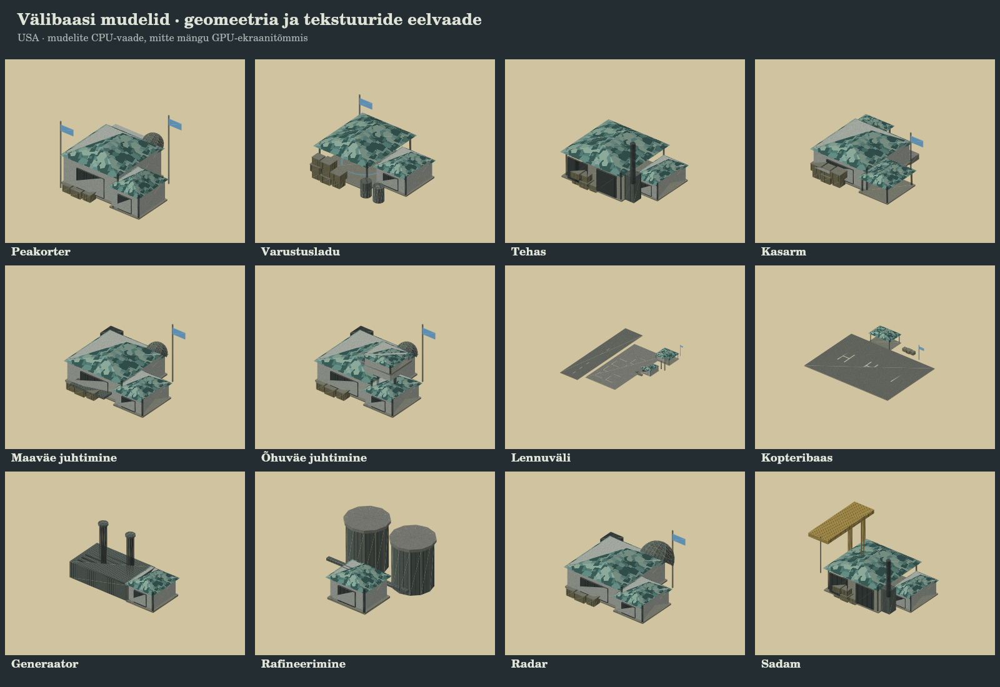

# Välibaasid, relvasuits ja kaardiväline varustus

## Mängimine

Alusta uut lahingut: majandus kasutab ruleset'i `2026-10-14.external-supply`. Vana salvestus jääb brauseris alles oma senise võtme all; seda ei laadita uue majanduse peale.

- Valmis, juhtimisvõrgu ja elektriga varustusladu tellib automaatselt koptereid kaardivälisest tagalast. Ladu ei vaja tellimiseks olemasolevat kütuse- ega moonajääki.
- Lao baasimport on 180 toorressurssi, järgmine väljasaatmine vähemalt 35 s pärast eelmist. Tasemed suurendavad koormat 70 võrra ja lühendavad väljasaatmise intervalli. Lennupark on piiratud: baastasemel kaks, kõrgemal kuni kolm kopterit lao kohta. Tegelik saabumissagedus sõltub ka lennuteekonna pikkusest ja vaba lennupargi olemasolust.
- Lennuväljast kuni 75 m kaugusel olev toimiv ladu avab suured kaubalennud. Esimene lend ei nõua lennuvälja uuendust. Lao/lennuvälja uuendused tõstavad lennupargi piiri, maksimaalset koormat ja tagala ettevalmistuskiirust.
- Raha ja ressursid lisanduvad ainult vastu võetud koorma eest. Lao tegelik moon, kütus ja remondivaru suurenevad sama tarnega. Täis lao juures ootab ülejääk pardal; osakoormat ei saa kaks korda rahaks teha.
- Pärast mahalaadimist lendab tarnija üle kaardi serva tagasi. Kui vastuvõtja kaob, otsib kaubalennuk teise sobiva lennuvälja; sobiva vastuvõtja puudumisel lahkub koormaga ilma väljamakseta. Allatulistatud lennu pardakoorem läheb kadunud varude arvestusse.
- Impordilennud tegutsevad iseseisvalt. Neid saab klõpsuga vaadata, kuid grupivalik ja liikumiskäsud ei suuna neid ümber. Lao „Veod peatatud” peatab ka impordi vastuvõtu.
- Ressursirajatised jäävad hõivatavaks/aktiveeritavaks lisasissetulekuks, mille kauba toovad endiselt päris veokid. Kaevandusel, naftaväljal, tehaseõuel ja depoos on oma jagatud maapinnatekstuur.

## Visuaalid ja töömaht

Rakettidel on eraldi piiratud aurupuhver. Mürskude jälg proovistatakse teepikkuse järgi, et eri kaadrisagedused ei muudaks jälje tihedust. Suits ja aur hajuvad pärast mürsu kadumist; kaugel/kaamera taga uusi osakesi ei lisata. Eksplosioonisuitsu ja raketiauru mahud on eraldi.

Puude pindalatihedus suureneb ning lähi-LOD lisab madalad põõsad. Põõsad ei kasva teele, vette, õue ega hoonesse ning jagavad olemasolevat metsapõlemise olekut. Kogu kaardi põõsaste ülempiir on 6500; need kasutavad instancing'ut, jagatud materjali ja geomeetriat ega heida lisavarje.

Sõjaväehoonete madalad kamuflaažkatused, avatud varjualused, kastid, tünnid, antennid, mahutid, tornid ja töökojad lähtuvad kasutaja Real Wari näidispildi vormidest. Geomeetria on projekti oma. Lennuvälja lennuraja ja parkimiskohtade asukohad säilivad. Bunkri ja õhutõrje relvatornid kasutavad endiselt olemasolevaid liikuvaid mudeleid.

Eelvaade näitab tegelike mudelite geomeetriat/UV-tekstuure eraldi CPU projitseerimisega. See ei kinnita mängu valgustust, GPU renderdust ega FPS-i.

## Jõnksutamise mõõtmine

Juhis: [PERFORMANCE-CAPTURE.md](PERFORMANCE-CAPTURE.md). Selle versiooni mõõtmiskontekst on `field-bases-imports1/performance-v2`.

Mõõda ühe raportiga kaamera liikumist linnade/metsade kohal ning teisega aktiivset raketilahingut. Vajuta **F8 → Uus mõõtmine**, oota 15 s paigal ja liigu/lahingi 45 s, seejärel **Salvesta JSON**. Lisa allalaaditud fail vestlusse. Võrdlus sama marsruudi teisel läbimisel aitab eristada esimese näitamise jõnksu pidevast koormusest.

## Kontrolli tulemus

- `npm run build` (sh TypeScripti kontroll) läbib.
- 25 sihitud tarne, Roheoru, Worldi ja renderduse kontrolli läbivad; mudelikontroll hõlmab kõiki 17 uut hoonesiluetti ning kuni kümmet materjalipartiid hoone kohta.
- 15 simuleeritud minuti AI taastumistest läbib: kaotatud pealadu/veokid asendatakse, pärast kaotust saabub üle 4100 kaardirajatiste koorma ühiku ning hiliste tankikaotuste järel tootmine jätkub. Test ei lõpeta majanduskontrolli varasema lahinguvõidu korral ega nõua üle oma armeeplaani tootmist.
- Täissuite läbis 249 testi 255-st. Selle jooksu uus AI armeeplaani eeldus parandati ja sama pikk test läbis eraldi korduskontrolli. Ülejäänud viis tõrget esinesid juba eelmisel main-il: CoreLoopi ehitusajastus, Integrationi fraktsiooni täpsuse eeldus, SystemsIntegrationi taxi/airborne ajastus, NavGridi 4 ms eelarve ja tacticalSupply kütusereservi eeldus. Täissuite ei ole roheline.
- GPU/WebGL brauserivaadet ning seadme FPS-i pole selle paketiga kinnitatud. CPU mudelieelvaade ja automaattestid seda ei asenda.
